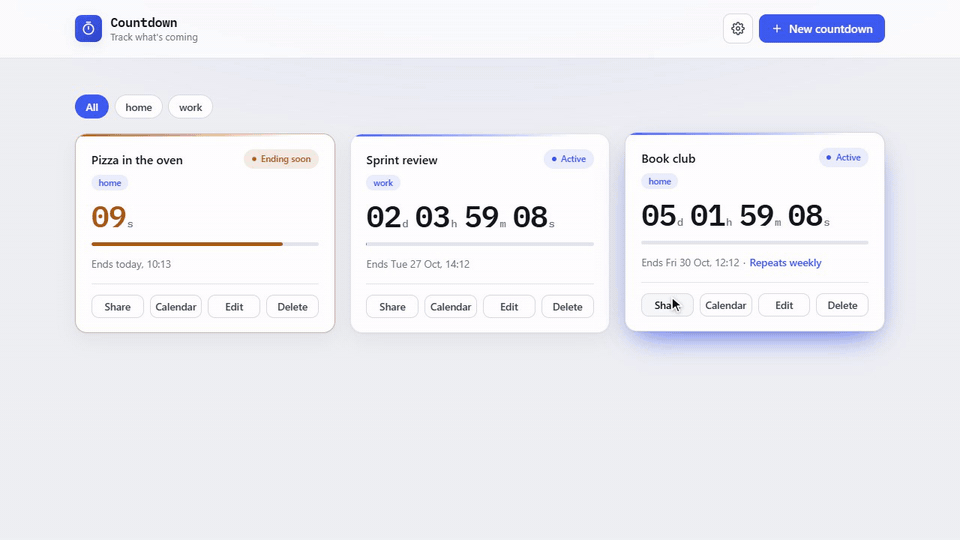
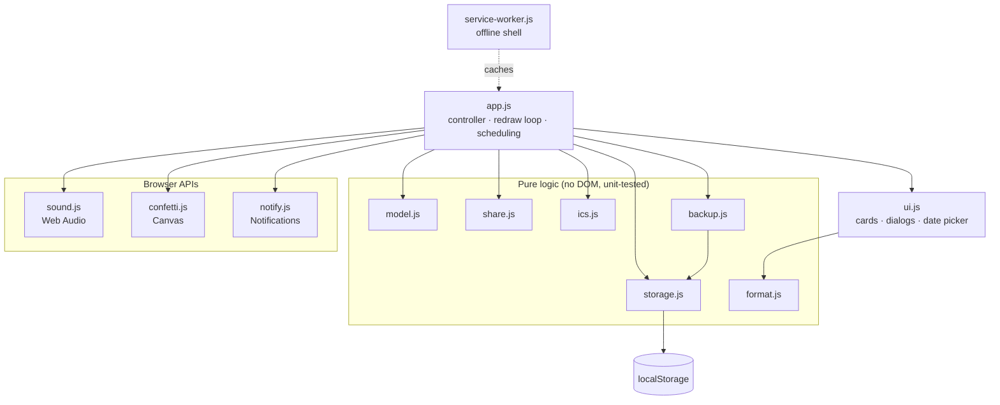
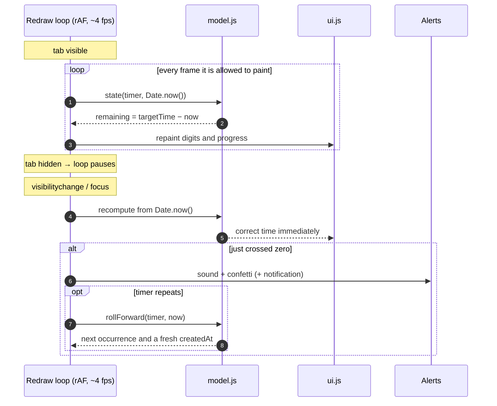

<div align="center">

# ⏱️ Countdown

[](https://github.com/pero-grubac/countdown/actions/workflows/ci.yml)
[](https://github.com/pero-grubac/countdown/actions/workflows/deploy.yml)


**Multiple countdown timers that stay exact through refreshes, closed tabs, offline periods and a sleeping laptop.**

[](https://pero-grubac.github.io/countdown/)



</div>

---

## 📌 Project Overview

**Countdown** tracks the moments you are waiting for: a deadline, a flight, a launch, a birthday or a 25-minute focus session. Create as many timers as you like and each one counts down live.

Every timer stores one absolute **target timestamp** and the display is always `target − now`. Nothing is decremented, so a timer cannot drift: it shows the right time after a refresh, a closed browser, a night offline or a laptop that slept through it.

Plain HTML, CSS and vanilla JavaScript. No framework, no build step, no backend, no tracking. It installs as a PWA and works fully offline.

---

## ✨ Features

- ⏳ **Two ways to count down**: a duration (`25 minutes`) or a specific date and time
- 🎯 **Accurate by design**: remaining time is always `targetTime − now`, so refreshes, sleep and offline gaps never throw it off
- 🔁 **Recurring timers**: daily, weekly, monthly or yearly. At zero the alert plays, then the timer starts over at its next date (Jan 31 monthly → Feb 28 → Mar 31; Feb 29 yearly → Feb 28 in other years)
- 🏷️ **Tags and a filter bar**: comma-separated tags shown as chips on each card; filter the grid by tag, and the choice is remembered
- 📅 **Add to calendar**: download any timer, or all of them, as a standard `.ics` file, with a repeat rule for recurring timers
- 🗄️ **Backup**: export your timers to a JSON file and import them on another device; imports are validated and merged by id
- 🗓️ **Custom date picker** with weeks starting on Monday, and a **24-hour**, **12-hour** or **Auto (your region)** clock
- 🔔 **Five alert sounds** (Chime, Bell, Marimba, Arcade, Alarm), chosen per timer and synthesized with the Web Audio API, so there are no audio files
- 🎉 **Confetti** when a timer ends, skipped automatically under reduced motion
- 🖥️ **Browser notifications** (optional), so a finished timer reaches you even when the tab is in the background
- 🔗 **Shareable links**: the countdown travels in the URL hash and stays **in sync across time zones**
- 💾 **Local only**: timers and settings live in `localStorage`; nothing leaves your device
- 📲 **Installable PWA** with an offline app shell, maskable icons and standalone display
- ♿ **Accessible**: keyboard navigation, focus-trapped dialogs, `role="timer"`, polite live regions, `prefers-reduced-motion`
- 🌗 **Light and dark** theme that follows the system; state is shown by label *and* colour, never colour alone

### 🧩 Timer states

| State | When | Shown as |
|-------|------|----------|
| **Active** | More than a minute left | Indigo pill and progress bar |
| **Ending soon** | Under 60 seconds left | Amber pill with a pulsing dot, amber digits and border |
| **Expired** | Reached zero | Red pill and `Expired`; stays until you delete it |

---

## 🛠️ Tech Stack

| Technology | Usage |
|------------|-------|
| HTML5 + CSS3 | Markup, design tokens, light/dark theme, responsive grid |
| Vanilla JavaScript (ES2020) | All logic: no framework, no state library |
| Web Audio API | Synthesized alert sounds |
| Canvas 2D | Confetti burst |
| Notification API | End-of-timer alerts in the background |
| Web Share / Clipboard API | Sharing countdown links |
| iCalendar (RFC 5545) | `.ics` calendar export, built by hand in `ics.js` |
| Blob / FileReader | Downloading `.ics` and JSON files, reading a backup to import |
| Service Worker | Offline app shell |
| `localStorage` | Timers and settings |
| IBM Plex Mono (Google Fonts) | Monospaced digits that don't jitter; the only external asset |
| `node:test` | Unit tests, no test framework to install |
| Playwright | End-to-end smoke tests on desktop and mobile Chromium |
| Lighthouse CI | Performance, accessibility, best-practice and SEO checks |
| GitHub Actions + GitHub Pages | CI and deployment |

---

## 📁 Project Structure

```
countdown/
├── index.html                 App shell: header, grid, create/edit dialog, settings
├── styles.css                 Design tokens, light/dark theme, layout, components
├── manifest.webmanifest       PWA metadata (name, icons, theme, standalone)
├── service-worker.js          Offline app-shell cache
├── favicon.svg                App mark (stopwatch)
├── icons/                     PWA icons: 192, 512, maskable 512, apple-touch
├── js/
│   ├── storage.js             Defensive localStorage wrapper for timers and settings
│   ├── format.js              Pure formatting: remaining time, target date, clock mode
│   ├── model.js               Timer creation, derived state / progress, recurrence, tags
│   ├── sound.js               Web Audio alert sounds (5 presets)
│   ├── confetti.js            Dependency-free canvas confetti
│   ├── notify.js              Notification API wrapper
│   ├── share.js               Share links: encode / decode via the URL hash
│   ├── ics.js                 iCalendar (.ics) builder for calendar export
│   ├── backup.js              JSON backup: export, validated import, merge by id
│   ├── ui.js                  DOM rendering, dialogs, the date picker
│   └── app.js                 Controller: state, CRUD, redraw loop, scheduling
├── tests/                     node:test suites for format, model, share, storage, ics, backup, service worker
│   └── e2e/                   Playwright smoke tests and a tiny static server
├── readme_assets/demo.gif     The demo above
├── package.json               npm scripts (start, test, test:e2e); Playwright is the only dev dependency
├── playwright.config.js       e2e config: desktop and mobile projects
├── lighthouserc.json          Lighthouse CI settings
└── .github/workflows/
    ├── ci.yml                 Unit, e2e and Lighthouse jobs on pull requests and feature branches
    └── deploy.yml             Unit and e2e tests, then deploy to GitHub Pages
```

---

## 📦 Installation

You need:

- [Git](https://git-scm.com/)
- [Node.js](https://nodejs.org/) 20 or newer, only for the tests and the local server. The app itself has no dependencies.

```bash
git clone https://github.com/pero-grubac/countdown.git
cd countdown
```

The app itself needs nothing installed; `npm install` only fetches Playwright for the end-to-end tests.

---

## ▶️ Usage

### Run locally

The app registers a Service Worker, so it has to be served over HTTP; `file://` will not work.

```bash
npm start                      # http://localhost:8080
# or
python -m http.server 8080     # then open http://localhost:8080
```

### Create a countdown

1. Click **New countdown**.
2. Give it a name (optional) and choose **A duration** or **A date & time**.
3. For a duration, type days / hours / minutes or use the quick chips (`+15m`, `+30m`, `+1h`, `+2h`). For a date, pick a day in the calendar and set the time.
4. Optionally choose how often it **Repeats** (Never, Daily, Weekly, Monthly, Yearly) and add **Tags** such as `work, family`.
5. Choose an alert sound (▶ **Preview** plays it) and click **Create countdown**.

Each card has **Share**, **Calendar**, **Edit** and **Delete**. Editing a duration starts it again from now, the way you would expect when changing "45 minutes" to "20 minutes".

### Recurring timers

A repeating timer plays its alert at zero as usual, then moves on to its next date and its progress bar starts again. Dates are counted from the first occurrence in local time, so a daily 09:00 stays at 09:00 across daylight-saving changes, and a monthly timer on the 31st lands on the last day of shorter months and returns to the 31st afterwards. If the app was closed through one or more occurrences, the timer skips straight to the next one in the future.

### Tags and filtering

Tags appear as small chips on the card. As soon as one timer has a tag, a filter bar shows above the grid: **All** plus one button per tag. The selected filter is remembered across visits.

### Add to calendar

**Calendar** on a card downloads that countdown as an `.ics` file; **Settings → Export all to calendar** downloads every countdown in one file. Events start at the target instant (in UTC), carry a reminder at that moment and, for recurring timers, an `RRULE` that follows the same month-end rule as the app (`FREQ=MONTHLY;BYMONTHDAY=31,-1;BYSETPOS=1` for the 31st).

### Backup and restore

**Settings → Export timers (JSON)** saves all timers to `countdown-backup-YYYY-MM-DD.json`. **Import timers (JSON)** reads such a file (or a plain array of timers), runs every record through the same validation as `localStorage`, merges by id and reports how many were added and updated. Invalid records are skipped.

### Share a countdown

**Share** copies a link (or opens the system share sheet on mobile). Whoever opens it gets the same countdown added to their list, ending at the same instant wherever they are.

```
https://pero-grubac.github.io/countdown/#c=<base64url({ id, n, t, c, s, r?, a? })>
```

Recurring timers add `r` (the repeat rule) and `a` (the first occurrence). Links without them still open as one-off countdowns.

### Settings

The ⚙️ button opens **Settings**: time format, sound on/off, confetti on/off, browser notifications, and the calendar and backup actions. The first time you turn notifications on, the browser asks for permission.

### Run the tests

```bash
npm test             # unit tests (node:test)
npm install          # once, for the end-to-end tests
npm run test:e2e     # Playwright smoke tests
```

The unit suites cover time formatting and pluralisation, timer creation and validation, state and progress, recurrence (month-end and leap-day clamping, skipping missed occurrences), tags, share links (including non-ASCII names, repeat rules and old or broken payloads), storage recovery from corrupt or blocked `localStorage` and from old records, the `.ics` builder (CRLF, UTC, escaping, line folding, RRULE), backup validation and merging, and that every file in `js/` is precached by the Service Worker.

The end-to-end tests run on desktop and mobile Chromium: creating a countdown, a daily timer rolling over to tomorrow, filtering by tag, calendar export, and a JSON export/import round-trip, all without console errors. Playwright downloads its browser with `npx playwright install chromium`, or you can point it at an existing one with `PW_CHROMIUM_PATH=/path/to/chrome`.

---

## 🏗️ Architecture

Logic is separated from rendering. The pure modules know nothing about the DOM, the UI knows nothing about persistence, and the controller wires them together.



### How a timer stays correct



### Data model

```js
{
  id:         "uuid",           // identity, never the array position
  name:       "Deadline",       // optional
  targetTime: 1790000000000,    // absolute instant, epoch ms: the source of truth
  createdAt:  1789990000000,    // start of the interval, for the progress bar
  sound:      "chime",          // alert played when this timer ends
  repeat:     "monthly",        // "never" | "daily" | "weekly" | "monthly" | "yearly"
  anchor:     1785000000000,    // first occurrence, only on recurring timers
  tags:       ["work", "bills"] // optional, shown as chips and used by the filter
}
```

Records saved before `repeat` and `tags` existed load as one-off, untagged timers. The selected tag filter is stored under its own key.

Settings (`timeFormat`, `sound`, `confetti`, `notify`) are stored under a separate key, and unknown or malformed values fall back to defaults.

---

## 🚀 CI/CD

| Workflow | Runs on | What it does |
|----------|---------|--------------|
| `ci.yml` | Pull requests and pushes to branches other than `main` | Three parallel jobs: **unit** (`npm test`), **e2e** (Playwright on desktop and mobile Chromium, traces uploaded on failure) and **Lighthouse** (audits exactly the files that get deployed, report uploaded as an artifact) |
| `deploy.yml` | Push to `main`, or a manual run | Unit and e2e tests, then publishes the site to GitHub Pages only if both pass |

Both workflows **skip documentation-only changes**: a commit that only touches `*.md`, `readme_assets/`, `LICENSE`, `.gitignore` or `.vscode/` does not start a run. A new run on the same branch cancels the one still in progress.

Only the files the site needs are deployed (`index.html`, `styles.css`, `manifest.webmanifest`, `service-worker.js`, `favicon.svg`, `js/`, `icons/`); tests and tooling are not.

**One-time setup:** in the repository open **Settings → Pages → Build and deployment → Source** and choose **GitHub Actions**. With "Deploy from a branch" GitHub would publish `main` directly and skip the tests.

> **After each release** bump `CACHE` in `service-worker.js` (e.g. `countdown-v7` → `countdown-v8`) so returning visitors get the new files. If you add a script to `js/`, add it to `SHELL` too; a test fails if one is missing.

---

## 🧭 Design Decisions

- **The target is the truth.** Storing an instant instead of a counter is what makes refreshes, sleep and time zones a non-issue.
- **Recurrence counts from the anchor.** Every occurrence is "first occurrence + n periods", never "previous occurrence + 1 period", so a monthly timer on the 31st doesn't get stuck on the 28th after February.
- **One gate for data.** Timers from `localStorage`, share links and backup files all pass through the same normalisation, so an old or hand-edited file can't break the app.
- **The loop only decides *when* to paint.** `requestAnimationFrame` throttled to ~4 fps, paused while hidden, with a forced repaint on `visibilitychange`.
- **No server, even for sharing.** The whole countdown fits in the URL hash, which never reaches a server and works on static hosting.
- **Notifications are best-effort.** Browsers throttle timers in background tabs, so a notification can arrive a little late; always-on-time delivery would need real push and a backend.
- **Storage can fail.** Corrupt JSON is cleared, invalid records are dropped, and blocked storage falls back to an in-memory session with a visible notice.
- **Relative paths everywhere**, so the app and its Service Worker work from a GitHub Pages project path (`/countdown/`) without configuration.

---

<div align="center">

*Everything runs in your browser. No accounts, no tracking, no ads.*

</div>
